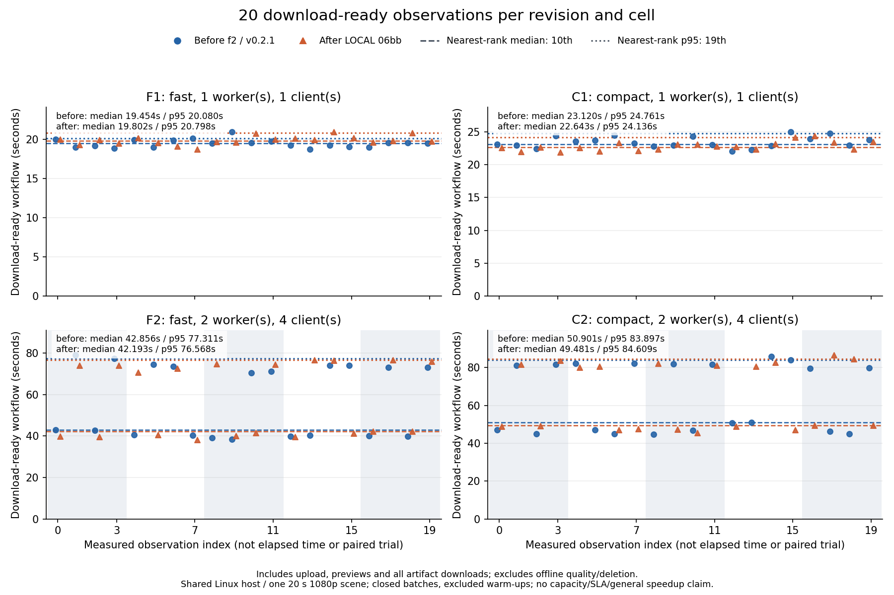

# Main1080 N20: exact archived before/after workflow observations

The accepted experiment completed 168 workflows (160 measured, 8 excluded warm-ups), 504 exports and 168 previews. Every output passed full decode/audio/content checks; deletion/accounting and exact owned cleanup passed. Results are mixed and descriptive: this is one scene on a shared Linux host, without a general speedup, capacity or SLA claim.

Before: `v0.2.1`, commit `f2be62c42a6a0d3d7a017b40bd683596bc578b95`. After: **local** candidate `06bb74bca90a79fbf399c01cf71f7f44af186431`, built with Go 1.27.2. The after archive is not the later EA/005 integration or a published 1.0 release. [Exact identities](INPUTS.json) and [archive provenance](after.SOURCE.json) are retained.

F1/C1 use fast/compact with one worker and one client. F2/C2 use fast/compact with two workers and four synchronized clients per closed batch (five batches). One full warm-up per binary/cell is excluded; each table uses all 20 measured observations. Nearest-rank median is the 10th sorted value; p95 the 19th. Change is `(after / before −1) ×100`; positive means longer observed duration. Values below are seconds.

## Download-ready workflow

| Cell | Before median | After median | Change | Before p95 | After p95 | Change |
| --- | ---: | ---: | ---: | ---: | ---: | ---: |
| F1 | 19.454 | 19.802 | +1.79% | 20.080 | 20.798 | +3.58% |
| C1 | 23.120 | 22.643 | -2.06% | 24.761 | 24.136 | -2.52% |
| F2 | 42.856 | 42.193 | -1.55% | 77.311 | 76.568 | -0.96% |
| C2 | 50.901 | 49.481 | -2.79% | 83.897 | 84.609 | +0.85% |

This endpoint includes fresh-owner upload, preview miss/hit, export queue/polling and **all artifact downloads**. Offline quality checks and deletion follow it.

[Standalone SVG](READY-OBSERVATIONS.svg). Every measured point is shown; index 0–19 is observation order, not elapsed time or a paired trial. Shaded four-client groups are synchronized closed batches. Warm-ups are retained in CSV but absent from these descriptors and the plot.

## Workflow through quality verification and deletion

| Cell | Before median | After median | Change | Before p95 | After p95 | Change |
| --- | ---: | ---: | ---: | ---: | ---: | ---: |
| F1 | 64.418 | 64.686 | +0.42% | 67.028 | 66.791 | -0.35% |
| C1 | 71.460 | 68.067 | -4.75% | 74.474 | 71.499 | -3.99% |
| F2 | 181.501 | 171.059 | -5.75% | 262.477 | 263.948 | +0.56% |
| C2 | 184.546 | 183.323 | -0.66% | 280.322 | 275.059 | -1.88% |

`validated_workflow_ms` ends after that owner’s offline media validation, DELETE 204 and deleted-route 404 checks. It includes waiting for the whole batch and earlier owners’ sequential verification/deletion. **Final physical and zero-ledger checks run after all row timestamps** and must pass before the batch is accepted; earlier row timings do not include that final query. `validation_ms` measures only the row’s own validation/deletion interval. These are harness intervals, not isolated encoder time or user-facing steady throughput.

## Resources, scope and evidence

API/worker/PostgreSQL quotas total 3 CPUs (0.5/2/0.5) on a shared 4-CPU host; memory limits 512/1536/768 MiB, swap 0. Idle quality verification requests 0.5 CPU / 512 MiB after media children become idle. FFmpeg threads 2, GOMAXPROCS 2, GOMEMLIMIT 128 MiB. Concurrent bounded source/Git/Python/ZIP/provider collection, pure controls and existing hash-pinned Go metadata reads are disclosed in INPUTS. There was no dedicated CPU or memory reservation.

Measured processing-round cgroup CPU deltas and phase/role sampled-memory maxima are in [CELL-METRICS.json](CELL-METRICS.json), alongside all raw workflow/export/queue descriptors. The 100 ms service samples observed aggregate current-memory maxima 921,030,656 B during processing, 327,299,072 B during idle validation and 432,513,024 B during warm-up. These are **sampled lower bounds**, include page cache and omit the idle-validator actual peak; summed RSS overlaps shared pages. Kernel memory.peak was unavailable. All 107,163 service samples had zero OOM/oom_kill/swap; sampled cumulative host OOM counter was unchanged.

Input: one licensed 20-second 1920×1080 SDR BT709/CFR30 camera derivative with stereo test tones; exports 2–8 seconds. Previews are 24 fps: before 854×480 / SAR 1280:1281; after 852×480 / SAR 1:1 (0.15625% displayed-aspect rounding difference). Full source-aligned SSIM floors are copy 0.99, accurate 0.90, preview 0.80; full audio spans, per-second stereo pulses, alignment and bounded copy packet tail passed. This does not establish UHD, long, HDR, VFR, rotation or multi-audio performance.

[WORKFLOW-TIMINGS.csv](WORKFLOW-TIMINGS.csv) contains 168 synthetic-ID rows including warm-ups; [EXPORT-TIMINGS.csv](EXPORT-TIMINGS.csv) contains 504 exports. Queue lower/upper bounds include HTTP/persisted-lease observation uncertainty, not an exact claim instant. Raw times remain unrounded; no retries, removed outliers, confidence intervals or arrival-capacity estimate.

The complete original corpus (9003 payloads, 4,254,820,360 B; 13 deterministic gzip/plain pairs) remains **local**. [RAW-MANIFEST.json](RAW-MANIFEST.json) is a selected integrity index, not a promise that the corpus is publicly downloadable. No original HTTP/DB/command/log bodies or credentials are copied here. [PUBLIC-MANIFEST.json](PUBLIC-MANIFEST.json) binds every delivered public file.

The first full N20 attempt failed on the sampler harness; its partial raw evidence remains failed and immutable. The original exception class was lost by the older harness and remains unknown. A minimal diagnostic/transient-child repair passed 68 pure controls and one bounded actual Linux child-disappearance control before this separately authorized run. This proves the handled Linux branch can occur, not the historical failure’s cause. Earlier failed pilots and the historical 32×5 ms storage-progress gate remain failed.

[Reproduction and availability](REPRODUCE.md), [fixture attribution/recipe](ATTRIBUTION.md). `harness-frozen/` preserves the exact four preparation sources; its README intentionally retains the historical pre-run N3/N20 proposal text. This accepted report records the later completed run; the historical snapshot has not been edited.
