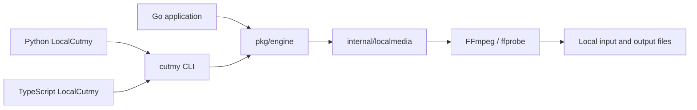
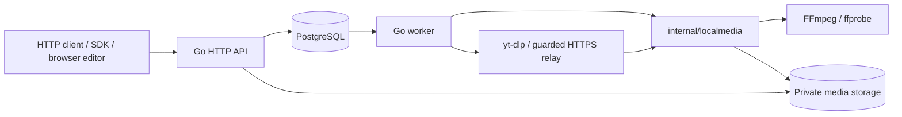

# Architecture and repository map

[Documentation index](README.md) · [Project overview](../README.en.md)

The repository contains a local Go engine, a CLI, an optional HTTP service and
client SDKs. They share cutting behavior; each interface has different runtime
requirements. The browser editor lives in the separate
[cutmyvideo-web](https://github.com/Kay0k1/cutmyvideo-web) repository.

## Local execution

`pkg/engine` is the public Go interface for inspection, individual exports,
saved plans and preflight. It launches external media tools within bounded
operations and validates/publishes their results. Its local operations do not
open PostgreSQL or start an HTTP service. Its runtime dependency graph does not
include the server package, database driver or HTTP stack.

The CLI exposes the same operations as JSON-oriented commands. Local SDKs invoke
an installed CLI with argument arrays, then return structured results and errors.
They do not implement another encoder. Go controls validation, execution and
publication; FFmpeg does media decoding, filtering, encoding and muxing.

Go callers compile their application; CLI consumers need the executable and
FFmpeg/ffprobe. Python local consumers additionally need Python 3.10+, and
TypeScript local consumers need Node.js 20.19+. No local workflow needs a database.

## HTTP execution

The API owns sessions, source admission, job submission and artifact access. A
worker processes the durable queue and uses the shared media operations behind
the engine. PostgreSQL stores metadata, immutable job parameters, status,
idempotency and storage/lease coordination. Media bytes live in shared storage,
rather than database rows. See the [HTTP contract](api.md) and
[security model](security-model.md) for ownership and limits.

Python and TypeScript HTTP clients run on the caller's machine; the server does
the cutting. The main TypeScript HTTP entry also works in browsers with modern
Fetch APIs. Its separate `@cutmyvideo/sdk/local` entry uses Node process and
filesystem APIs.

The Node-only `@cutmyvideo/sdk/collections` entry and Python collection runner
coordinate the [complete HTTP project cycle](sdk-collections.md). Private local
state stores accepted job IDs and verified receipts; a separate file stores the
owner capability. Recovery uses the existing queue and artifacts without a new
server scheduler, schema or encoder.

Platform import uses yt-dlp with a Node.js runtime; the server image bundles
these alongside FFmpeg. Node is an import dependency, not an alternative media
engine. Uploaded/local server files do not require platform extraction.

## Internal component boundaries

`internal/edit` owns the edit models and pure rules for ranges, crop, inherited
collection options, selected clips and aggregate limits. It uses only the Go
standard library and receives small source/limit views, without database,
HTTP, filesystem or media-tool dependencies. Both server and local execution
use these rules. Existing public Go shapes and the request-validation method
remain available through compatible aliases and adapters.

Project domain records live in `internal/app/project.go`. Project reads,
creation, edits, handoffs, grants, retries and scoped job bindings live in
`internal/app/store_projects.go`, including their existing transactions and
authorization fences. `http_projects.go` handles request decoding, rate limits,
database deadlines, response errors and project-scoped URLs. Storage reads keep
canonical source/artifact URLs; the HTTP boundary rewrites them for project access.

`internal/subtitles` owns supplied SRT/VTT retiming, extracted-source SRT parsing,
subtitle cue indexing and clock formatting. It depends only on the standard library and `internal/edit`;
it does not open files, run media tools or depend on HTTP or database code.
The public engine calls it directly, while app aliases preserve the existing
request/result/error types. Extracted-source SRT parsing remains distinct from
the stricter supplied-text parser. Source inspection and subtitle tool execution
and muxing run through `internal/localmedia`; operation-local caches belong to
`internal/mediasession`.

`internal/toolrun` owns the sanitized subprocess environment, process-tree
containment on Unix/Windows, bounded stderr and fixed failure classification.
It returns elapsed time and the raw process error to its caller. The local media
backend retains cancellation precedence and stdout policies: buffered inspection
is bounded, while streaming operations use their own writers and limits. The
service installs a process observer for worker diagnostics and translates media
errors to its existing private wrappers. The runner has no server configuration,
HTTP or database dependency.

`internal/mediainfo` owns bounded probe metadata, finite-duration validation,
deterministic stream selection, track manifests and pure video geometry/filter
construction. It uses only the standard library and `internal/edit`; it does not
run FFprobe, open files or access server configuration. The app layer converts
its classified failures back to the existing error types and unsupported-stream
sentinel, while ordinary validation errors keep their causes. Unknown display
geometry continues to leave coded dimensions and unrelated audio inspection
available; rendering validates geometry when an operation needs it.

`internal/mediaexport` coordinates individual and joined exports, including
copy/accurate selection, ordered concat plans, repeated-interval reuse, audio
alignment, requested/measured timelines and output verification. It owns FFmpeg
arguments and pure output budgets. Filesystem, process, inspection and subtitle
effects run through local media runtime adapters at their original positions in
the operation. The package itself has no filesystem, process, network or database
dependency. Bounded/streaming stdout, diagnostic causes, decoder-slot ownership
and explicit final/intermediate flags retain their existing behavior.

`internal/mediapreflight` owns advisory report planning, request/track/geometry
decisions, exact capability-table parsing and batch capability-name unions. Each
report owns its normalized request; later request errors retain their original
position after earlier capability checks. Local media adapters keep fresh source/tool
identity fences, query deadlines, bounded responses and fatal OS errors. A
successful preflight still promises neither decoding nor storage/publication.

`internal/mediasession` owns one local operation's pinned file metadata, bounded
keyframe lookahead, disk-backed source text and single resident subtitle index.
It also copies verified repeated outputs into independent files. It uses the
filesystem and neutral media packages, with callbacks for actual media-tool
queries; it has no HTTP, SQL, queue or subprocess dependency. App retains the
context compatibility wrapper over the same local media session, authorization,
reader pins and the separate
cross-operation metadata cache's owner keys, TTL and eviction policy.

`internal/localmedia` owns concrete tool invocation, probe/keyframe queries,
subtitle extraction/muxing, capability snapshots and bounded owned-output
scanners. It connects the pure coordinators to the filesystem and process runner.
Both engine and service use this backend; the engine has no dependency on
`internal/app`, including through intermediate packages.

`internal/coremodel` owns compatibility data types, the existing request
validation method and shared startup/storage sentinels. App aliases retain their
complete field shapes and assignment compatibility. The full legacy config and
source shapes remain here to preserve `PreflightRequest.Validate` without
importing server behavior; environment loading and persistence stay in app.
`internal/mediaerror` owns fixed media diagnostics, classification and causes.
App adapters retain private error types and sentinel identity. Runtime dependency
guards and an external Go consumer verify this boundary and public contracts.

Remote/HLS preparation, authorization, decoder admission, cross-operation
caches and worker leases remain service responsibilities. Durable publication
continues to use `internal/fsdurable` at the engine and service boundaries.

## Why SQL and JavaScript are here

- `internal/app/migrations/*.sql` are versioned PostgreSQL schema changes.
  Go embeds them in the binary and the service's store startup applies pending
  migrations. They serve the HTTP/worker persistence path, not local cutting.
- `deploy/public-bootstrap.sql` and `public-grants.sql` establish database roles
  and access for the public hosting profile. Historical SQL under
  `internal/app/testdata/migrations/` exercises upgrade compatibility.
- `sdk/typescript/src/*.ts` is SDK source. The TypeScript compiler produces
  `dist/*.js` and declaration files for the distributed package; generated output
  is ignored in Git. `.mjs` files under SDK tests and `scripts/sdk-smoke.mjs`
  are executable JavaScript checks for the installed client.
- Python scripts under `scripts/` and `deploy/` support testing, packaging and
  operations. The Python SDK is a separate client package.

Choosing a local interface does not require running the server stack or
installing the other language's SDK.

## Repository map

| Path | Purpose |
| --- | --- |
| `pkg/engine/` | Public Go library and its tests |
| `cmd/cutmy/` | Local CLI, API/worker/maintenance entry points |
| `internal/app/` | Server/queue/storage implementation and media compatibility adapters |
| `internal/localmedia/` | Concrete media runtime, local sessions, tool queries and owned-output scanners |
| `internal/coremodel/` | Shared compatibility data, request-validation method and sentinels |
| `internal/mediaerror/` | Portable media diagnostics, classification and cause chains |
| `internal/edit/` | Standard-library-only edit models, validation and collection normalization |
| `internal/mediaexport/` | Individual/joined export planning, coordination, budgets and result verification |
| `internal/mediainfo/` | Pure probe metadata, track decisions and video geometry/filter rules |
| `internal/mediapreflight/` | Pure advisory reports, capability decisions and batch planning |
| `internal/mediasession/` | Local operation identity, bounded caches, lifecycle and independent result reuse |
| `internal/subtitles/` | Pure supplied-text retiming, cue indexing and clock formatting |
| `internal/toolrun/` | External tool execution, bounded diagnostics and platform process containment |
| `internal/app/migrations/` | Versioned SQL and expected database catalog layouts |
| `internal/fsdurable/` | Durable filesystem publication support |
| `sdk/python/`, `sdk/typescript/` | Client libraries, package guides and tests |
| `api/` | OpenAPI, schemas and compatibility baseline |
| `examples/` | Saved cutting plans |
| `docs/` | Usage, architecture, operations and release guides |
| `deploy/`, `Dockerfile` | Optional server installation and container runtime |
| `scripts/`, `.github/` | Checks, packaging, CI and contribution templates |
| `benchmarks/`, `verification/` | Reproduction tooling, compact observations and retained evidence references |

Public Go callers import `pkg/engine`; `internal/app` is implementation detail,
not a supported integration API. The engine and service share the internal media
backend without importing each other. They remain part of one versioned Go
module. See
[performance](performance.md) for measured costs and
[artifact retention](artifacts.md) for generated diagnostics.
