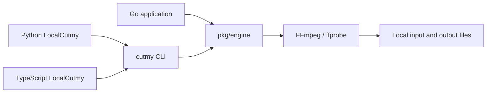
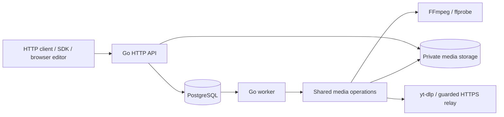

# Architecture and repository map

[Documentation index](README.md) · [Project overview](../README.en.md)

The repository contains a local Go engine, a CLI, an optional HTTP service and
client SDKs. They share cutting behavior; each interface has different runtime
requirements. The browser editor lives in the separate
[cutmyvideo-web](https://github.com/Kay0k1/cutmyvideo-web) repository.

## Local execution

`pkg/engine` is the public Go interface for inspection, individual exports,
saved plans and preflight. It launches external media tools within bounded
operations and validates/publishes their results. Its local operations do not
open PostgreSQL or start an HTTP service.

The CLI exposes the same operations as JSON-oriented commands. Local SDKs invoke
an installed CLI with argument arrays, then return structured results and errors.
They do not implement another encoder. Go controls validation, execution and
publication; FFmpeg does media decoding, filtering, encoding and muxing.

Go callers compile their application; CLI consumers need the executable and
FFmpeg/ffprobe. Python local consumers additionally need Python 3.10+, and
TypeScript local consumers need Node.js 20.19+. No local workflow needs a database.

## HTTP execution

The API owns sessions, source admission, job submission and artifact access. A
worker processes the durable queue and uses the shared media operations behind
the engine. PostgreSQL stores metadata, immutable job parameters, status,
idempotency and storage/lease coordination. Media bytes live in shared storage,
rather than database rows. See the [HTTP contract](api.md) and
[security model](security-model.md) for ownership and limits.

Python and TypeScript HTTP clients run on the caller's machine; the server does
the cutting. The main TypeScript HTTP entry also works in browsers with modern
Fetch APIs. Its separate `@cutmyvideo/sdk/local` entry uses Node process and
filesystem APIs.

The Node-only `@cutmyvideo/sdk/collections` entry and Python collection runner
coordinate the [complete HTTP project cycle](sdk-collections.md). Private local
state stores accepted job IDs and verified receipts; a separate file stores the
owner capability. Recovery uses the existing queue and artifacts without a new
server scheduler, schema or encoder.

Platform import uses yt-dlp with a Node.js runtime; the server image bundles
these alongside FFmpeg. Node is an import dependency, not an alternative media
engine. Uploaded/local server files do not require platform extraction.

## Internal component boundaries

`internal/edit` owns the edit models and pure rules for ranges, crop, inherited
collection options, selected clips and aggregate limits. It uses only the Go
standard library and receives small source/limit views, without database,
HTTP, filesystem or media-tool dependencies. Both server and local execution
use these rules. Existing public Go shapes and the request-validation method
remain available through compatible aliases and adapters.

Project domain records live in `internal/app/project.go`. Project reads,
creation, edits, handoffs, grants, retries and scoped job bindings live in
`internal/app/store_projects.go`, including their existing transactions and
authorization fences. `http_projects.go` handles request decoding, rate limits,
database deadlines, response errors and project-scoped URLs. Storage reads keep
canonical source/artifact URLs; the HTTP boundary rewrites them for project access.

`internal/subtitles` owns supplied SRT/VTT retiming, subtitle cue indexing and
clock formatting. It depends only on the standard library and `internal/edit`;
it does not open files, run media tools or depend on HTTP or database code.
The public engine calls it directly, while app aliases preserve the existing
request/result/error types. Extracted-source SRT parsing remains distinct from
the stricter supplied-text parser. Source inspection, cache ownership and
subtitle extraction/muxing remain in the app layer.

`internal/toolrun` owns the sanitized subprocess environment, process-tree
containment on Unix/Windows, bounded stderr and fixed failure classification.
It returns elapsed time and the raw process error to its caller. The app layer
retains worker diagnostics, cancellation precedence, its existing error wrappers
and stdout policies: buffered inspection is bounded, while streaming operations
use their own writers and limits. The runner has no server configuration,
HTTP or database dependency.

`internal/mediainfo` owns bounded probe metadata, finite-duration validation,
deterministic stream selection, track manifests and pure video geometry/filter
construction. It uses only the standard library and `internal/edit`; it does not
run FFprobe, open files or access server configuration. The app layer converts
its classified failures back to the existing error types and unsupported-stream
sentinel, while ordinary validation errors keep their causes. Unknown display
geometry continues to leave coded dimensions and unrelated audio inspection
available; rendering validates geometry when an operation needs it.

Media probing, encoding coordination and queue handling still share
`internal/app`. The public engine therefore retains compile-time dependencies
on that package; local operations continue to run without opening a database.
These smaller internal boundaries support further media separation without
changing the existing public Go interfaces.

## Why SQL and JavaScript are here

- `internal/app/migrations/*.sql` are versioned PostgreSQL schema changes.
  Go embeds them in the binary and the service's store startup applies pending
  migrations. They serve the HTTP/worker persistence path, not local cutting.
- `deploy/public-bootstrap.sql` and `public-grants.sql` establish database roles
  and access for the public hosting profile. Historical SQL under
  `internal/app/testdata/migrations/` exercises upgrade compatibility.
- `sdk/typescript/src/*.ts` is SDK source. The TypeScript compiler produces
  `dist/*.js` and declaration files for the distributed package; generated output
  is ignored in Git. `.mjs` files under SDK tests and `scripts/sdk-smoke.mjs`
  are executable JavaScript checks for the installed client.
- Python scripts under `scripts/` and `deploy/` support testing, packaging and
  operations. The Python SDK is a separate client package.

Choosing a local interface does not require running the server stack or
installing the other language's SDK.

## Repository map

| Path | Purpose |
| --- | --- |
| `pkg/engine/` | Public Go library and its tests |
| `cmd/cutmy/` | Local CLI, API/worker/maintenance entry points |
| `internal/app/` | Shared media operations and internal server/queue/storage implementation |
| `internal/edit/` | Standard-library-only edit models, validation and collection normalization |
| `internal/mediainfo/` | Pure probe metadata, track decisions and video geometry/filter rules |
| `internal/subtitles/` | Pure supplied-text retiming, cue indexing and clock formatting |
| `internal/toolrun/` | External tool execution, bounded diagnostics and platform process containment |
| `internal/app/migrations/` | Versioned SQL and expected database catalog layouts |
| `internal/fsdurable/` | Durable filesystem publication support |
| `sdk/python/`, `sdk/typescript/` | Client libraries, package guides and tests |
| `api/` | OpenAPI, schemas and compatibility baseline |
| `examples/` | Saved cutting plans |
| `docs/` | Usage, architecture, operations and release guides |
| `deploy/`, `Dockerfile` | Optional server installation and container runtime |
| `scripts/`, `.github/` | Checks, packaging, CI and contribution templates |
| `benchmarks/`, `verification/` | Reproduction tooling, compact observations and retained evidence references |

Public Go callers import `pkg/engine`; `internal/app` is implementation detail,
not a supported integration API. Server code and shared media helpers currently
coexist in that internal package. The separation above describes execution and
public interfaces, not independently versioned Go modules. See
[performance](performance.md) for measured costs and
[artifact retention](artifacts.md) for generated diagnostics.
