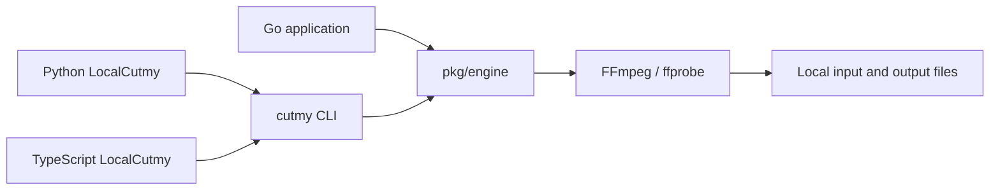
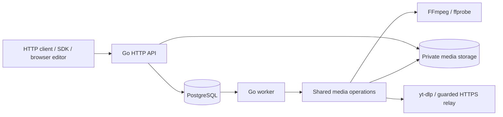

# Architecture and repository map

[Documentation index](README.md) · [Project overview](../README.en.md)

The repository contains a local Go engine, a CLI, an optional HTTP service and
client SDKs. They share cutting behavior; each interface has different runtime
requirements. The browser editor lives in the separate
[cutmyvideo-web](https://github.com/Kay0k1/cutmyvideo-web) repository.

## Local execution

`pkg/engine` is the public Go interface for inspection, individual exports,
saved plans and preflight. It launches external media tools within bounded
operations and validates/publishes their results. Its local operations do not
open PostgreSQL or start an HTTP service.

The CLI exposes the same operations as JSON-oriented commands. Local SDKs invoke
an installed CLI with argument arrays, then return structured results and errors.
They do not implement another encoder. Go controls validation, execution and
publication; FFmpeg does media decoding, filtering, encoding and muxing.

Go callers compile their application; CLI consumers need the executable and
FFmpeg/ffprobe. Python local consumers additionally need Python 3.10+, and
TypeScript local consumers need Node.js 20.19+. No local workflow needs a database.

## HTTP execution

The API owns sessions, source admission, job submission and artifact access. A
worker processes the durable queue and uses the shared media operations behind
the engine. PostgreSQL stores metadata, immutable job parameters, status,
idempotency and storage/lease coordination. Media bytes live in shared storage,
rather than database rows. See the [HTTP contract](api.md) and
[security model](security-model.md) for ownership and limits.

Python and TypeScript HTTP clients run on the caller's machine; the server does
the cutting. The main TypeScript HTTP entry also works in browsers with modern
Fetch APIs. Its separate `@cutmyvideo/sdk/local` entry uses Node process and
filesystem APIs.

Platform import uses yt-dlp with a Node.js runtime; the server image bundles
these alongside FFmpeg. Node is an import dependency, not an alternative media
engine. Uploaded/local server files do not require platform extraction.

## Why SQL and JavaScript are here

- `internal/app/migrations/*.sql` are versioned PostgreSQL schema changes.
  Go embeds them in the binary and the service's store startup applies pending
  migrations. They serve the HTTP/worker persistence path, not local cutting.
- `deploy/public-bootstrap.sql` and `public-grants.sql` establish database roles
  and access for the public hosting profile. Historical SQL under
  `internal/app/testdata/migrations/` exercises upgrade compatibility.
- `sdk/typescript/src/*.ts` is SDK source. The TypeScript compiler produces
  `dist/*.js` and declaration files for the distributed package; generated output
  is ignored in Git. `.mjs` files under SDK tests and `scripts/sdk-smoke.mjs`
  are executable JavaScript checks for the installed client.
- Python scripts under `scripts/` and `deploy/` support testing, packaging and
  operations. The Python SDK is a separate client package.

Choosing a local interface does not require running the server stack or
installing the other language's SDK.

## Repository map

| Path | Purpose |
| --- | --- |
| `pkg/engine/` | Public Go library and its tests |
| `cmd/cutmy/` | Local CLI, API/worker/maintenance entry points |
| `internal/app/` | Shared media operations and internal server/queue/storage implementation |
| `internal/app/migrations/` | Versioned SQL and expected database catalog layouts |
| `internal/fsdurable/` | Durable filesystem publication support |
| `sdk/python/`, `sdk/typescript/` | Client libraries, package guides and tests |
| `api/` | OpenAPI, schemas and compatibility baseline |
| `examples/` | Saved cutting plans |
| `docs/` | Usage, architecture, operations and release guides |
| `deploy/`, `Dockerfile` | Optional server installation and container runtime |
| `scripts/`, `.github/` | Checks, packaging, CI and contribution templates |
| `benchmarks/`, `verification/` | Reproduction tooling, compact observations and retained evidence references |

Public Go callers import `pkg/engine`; `internal/app` is implementation detail,
not a supported integration API. Server code and shared media helpers currently
coexist in that internal package. The separation above describes execution and
public interfaces, not independently versioned Go modules. See
[performance](performance.md) for measured costs and
[artifact retention](artifacts.md) for generated diagnostics.
